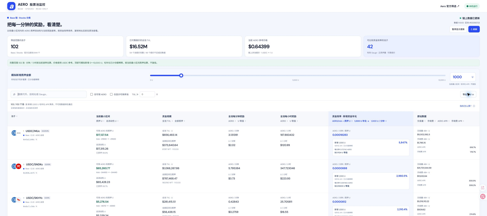

# AERO 股票与黄金池监控

[](https://github.com/shuangzhou8/aero-stock-monitor/actions/workflows/test.yml)

监控 **Base 链的股票与黄金池**，比较 AERO 奖励、有效质押量和新增资金年化，并记录官方注册表的新池与首次检测到的 AERO 奖励。

只读应用，使用公开 RPC。无需钱包、私钥或 API Key。



## 能看到什么

- 代币图标、交易对、池类型、地址复制和官方池子入口。
- 股票 / 黄金分类筛选，顶部单独展示黄金池每小时 AERO 排放。
- 新池与新开启奖励面板：覆盖全部官方登记池，显示创建时间、发现时间、奖励状态、每小时排放及来源区块，支持筛选和 CSV 导出。
- 当前最小 tick 区间：可领 AERO 的质押价值、总流动性及质押占比。
- 全池 TVL，以及独立核实的全部区间质押 NFT 本金。
- 每分钟 / 每小时 AERO 排放数量及 USDC 参考等值。
- 资金效率：每分钟 AERO ÷ 当前最小区间已质押 U。
- 顶部 0～10,000 U 滑块：模拟新增本金后的个人分钟奖励和毛年化 APR，已计入份额稀释。
- 搜索、筛选、列排序、CSV 导出；小窗口自动切换卡片布局。
- 默认按当前模拟金额的新增资金年化降序排序；未加仓效率独立排序，低于 0.1% 的年化保留更多小数。

## 最新更新 · 2026-11-07

新增黄金池监控、全部登记池的新增与奖励开启记录；同步年化排序和小数显示修复。Mac、Windows、Linux 使用相同源码。

已有克隆可以在项目目录执行 `git pull --ff-only`，然后运行 `npm ci`、`npm start`。更新前先停止原服务，更新后刷新浏览器。使用 ZIP 安装时重新下载最新版并解压到新目录。

## 快速启动

需要 **Node.js 22 或更新版本**及 npm，适用于 macOS、Windows、Linux。

在下载的项目目录打开终端：

```sh
npm ci
npm start
```

浏览器打开 **http://127.0.0.1:4381/**。在终端按 `Ctrl+C` 停止服务。

也可以从 GitHub 点击 **Code → Download ZIP**，解压后执行上述命令。Mac 后台启动：先在项目目录执行 `chmod +x Start.command`，再双击 `Start.command`；首次使用先安装 Node.js。直接使用 `npm start` 无需修改文件权限。

如果 4381 端口被占用，可设置其他端口：

```sh
# macOS / Linux
PORT=4382 npm start
```

```powershell
# Windows PowerShell
$env:PORT=4382
npm start
```

本地地址只在运行服务的电脑上生效。项目包含 Node.js 数据读取服务，GitHub Pages 单独托管静态文件无法运行完整看板。

## 奖励和年化怎么算

以当前最小 tick 区间为模拟范围：

```text
S = 当前最小区间内、可领 AERO 的原质押价值（U）
D = 模拟新增 LP 价值（U）
R = 全池当前 AERO / 分钟
P = 当前 AERO 的 USDC 参考价

个人 AERO / 分钟 ≈ R × D / (S + D)
个人 U / 分钟 ≈ R × P × D / (S + D)
毛年化 APR（%）≈ R × P / (S + D) × 525600 × 100
```

区间金额按实际 `tickSpacing` 和整数 TickMath 计算。这里的 S 是当前有效区间质押价值；全池 TVL 和全部区间质押本金另列展示。

年化按一年 365 天、不复投的当前速率外推，假设新增仓位选择 AERO 奖励、处于当前最小区间内。个人退出罚款、推荐分成、Gas、币价波动损益另算；手续费收益未计入此年化。0 U 时个人奖励为零，年化留空。

## 数据和报价

- [官方筛选范围](https://app.aero.xyz/liquidity/pools?sort=apr&chainIds=%5B8453%5D&tiers=%5B50%5D)：Base / Stocks；`tiers=[50]` 是股票分类。
- 黄金分类为 tier `25`；主列表也包含双方已列出且至少一方属于黄金分类的池子。新增记录检查 Base 全部官方登记池。
- Base 公共 RPC：`base-rpc.publicnode.com`、`mainnet.base.org`，可在 `lib/rpc.mjs` 修改。
- 官方 Sugar：`0x082965f28c1aF8c7e236F8A8909596B01D8C6e72`。
- 当前 AERO：`0x3f5bf3edac59d650d8fdf9657a71f2f904a3a4ee`。
- 每分钟 / 小时排放：Sugar 当前每秒速率乘 60 / 3600。
- 开源版使用独立的链上报价实现：USDC 锚定，最多 3 跳，单条有效报价深度至少 1,000 U；按深度加权中位数剔除偏离超过 33% 的报价，再选保留报价中深度最大的池。没有足够深度时显示报价不足。
- 报价使用集中流动性池现价、普通池储备比，以及稳定池不变量的边际价格。公开版参考价可能与官方网页或早期本地版有细微差别。

每 5 分钟校验池分类与注册表，主数据每 10 秒尝试刷新。全部质押本金按 NFT 逐池核实，独立显示来源时间。公共 RPC 限流时保留并标记旧数据。

新增池与首次 AERO 排放分别记录，以完整读取并核对来源区块的注册表为准。链上创建时间与本机发现时间分别显示。首次启动以仓库种子快照为比较基准，后续历史保存在本机 `var/discovery-log.json`，重启会恢复；新登记池尚未开启奖励时也可在关闭正排放筛选后查看。

`data/` 保存一份公开链上种子快照，供首次启动与离线测试使用；启动后自动更新。`var/` 是本机运行缓存，不提交到仓库。

## 开发

```sh
npm test
```

测试覆盖最小区间整数计算、负 tick、无报价及零分母、质押份额稀释、报价深度和多跳、RPC 并发与限流、后台 NFT 读取与主刷新隔离，以及黄金分类、新池登记、奖励开启、历史恢复和注册表完整性。测试无需访问区块链。

```text
server.mjs       本地 HTTP 服务
lib/             数据采集、报价、整数计算
public/          无构建步骤的前端
data/            公开链上快照与 ABI
tests/           Node.js 测试
docs/            看板截图与数据说明
```

## 开源许可

代码采用 **GPL-2.0-or-later**，可使用、修改和分发；分发修改版时保留许可并提供相应源码。详见 [LICENSE](LICENSE) 和 [第三方来源说明](THIRD_PARTY_NOTICES.md)。

这是社区监控工具。Aero、Base 及代币商标属于各自权利人。
